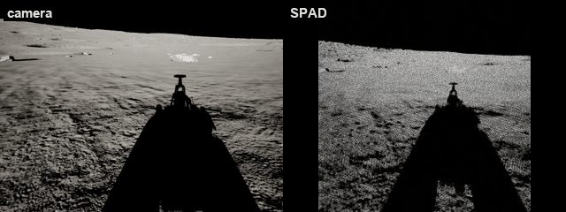

# UnrealSPADCam

The Unreal side of a simulated single-photon (SPAD) camera: it renders the
scene and streams grayscale frames to ROS over TCP, where the photon model runs.

*The rover driving in MARE: the camera (left) and the SPAD
frames after the photon model (right).*

Part of [MARE](https://github.com/raulcastar/MARE-Lunar-Simulator), an open-source lunar rover
simulation suite. In its ROS 2 stack,
[GNC-Moon-Simulator](https://github.com/raulcastar/GNC-Moon-Simulator), the `component_spad_camera` node turns the frames into single-photon binary
frames with [spadSim](https://github.com/drodriguezSRL/spadSim) (port 3006).

## Requirements

Unreal Engine 5.7 on Windows (the version it is developed and tested with).
Building from source also needs Visual Studio 2022 with the *Game development
with C++* workload.

On the ROS side: ROS 2 Jazzy (Ubuntu 24.04), with the
`component_spad_camera` node of GNC-Moon-Simulator receiving the stream. The plugin itself has no ROS
dependency: any program that reads the [wire format](docs/wire-format.md) can use it.

## Install

- **Prebuilt (UE 5.7, Win64):** download `UnrealSPADCam-<version>-UE5.7-Win64.zip`
  from [Releases](https://github.com/raulcastar/UnrealSPADCam/releases) and extract it
  into `<YourProject>/Plugins/`.
- **From source:** clone this repository into `<YourProject>/Plugins/UnrealSPADCam`,
  open the project and answer **Yes** to rebuild the module.

Then check it is enabled under *Edit → Plugins → Project → Other*.

## Use

1. Add a **SceneCaptureComponent2D** named `SPADCam` where the sensor sits.
2. Add the **UnrealSPADCam** component to the same actor.
3. Press Play: frames go to `127.0.0.1:3006`.

## Dependencies

None to build or run: only engine modules. It stamps its data with the shared
simulation time (its own copy of `GncSimTime.h`); add
[UnrealSimClock](https://github.com/raulcastar/UnrealSimClock) so ROS gets `/clock` on the same time base.

## Docs

| | |
|---|---|
| [Setup in detail](docs/setup.md) | Installing, the capture, the component |
| [Parameters](docs/parameters.md) | Network and camera settings |
| [How it works](docs/how-it-works.md) | SPAD cameras; where the model lives |
| [Wire format](docs/wire-format.md) | The TCP packet layout |
| [Making a release](docs/release.md) | Building the prebuilt zip for GitHub releases |

## License

[MIT](LICENSE), © 2026 Raul Castilla Arquillo. The photon model it feeds (in
GNC's `component_spad_camera`) is ported from
[spadSim](https://github.com/drodriguezSRL/spadSim), MIT, © 2025 David
Rodriguez-Martinez.
